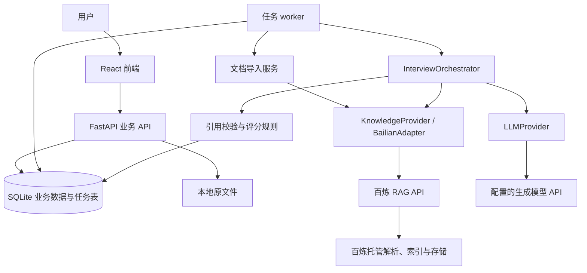

# 基于知识库的面试练习智能体：项目架构与需求文档

版本：V1.5 需求基线（Agent 原理与系统首批演示）  
日期：2026-11-09  
状态：需求与架构方案；百炼系统库 11 份 Markdown 已可检索，已发布知识检索服务；补传后 12/12 条固定主测均在第 1 位命中支持答案的资料；前端仍为演示数据，后端业务服务与模型联调未完成  
用途：课程项目立项、开发拆解、接口协作、实现验收与后续迭代

## 1. 项目定位

系统提供两个独立入口：模拟面试还原开场、项目、技术、行为和候选人反问等完整交流，依据本场覆盖与信息充分性结束；试题练习一次随机抽取一道合格题，回答后立即查看反馈并选择重答或下一题。用户选择已开放的岗位方向和难度即可开始；自定义 JD、简历、项目背景和学习资料均可选。技术判断和反馈须有可追溯依据，并保存完整记录。

核心流程：

> 模拟面试：选择岗位包 → 可选提供并确认 JD/简历 → 建立本场能力覆盖计划 → 自我介绍、项目/经历、技术与行为交流、候选人反问 → 按回答补问或换题 → 覆盖与信息充分时结束并复盘。试题练习：选择方向/能力/难度 → 随机抽一道已发布题 → 作答 → 即时反馈 → 后续可重答或抽下一题。

第一版面向个人学习与本地演示。采用“单个面试流程控制器 + 分阶段模型调用 + 知识检索工具”，不要求先搭建多 Agent 系统。

### 1.1 参考项目与借鉴范围

| 来源 | 借鉴内容 | 本项目的落实方式 |
| --- | --- | --- |
| DeepInterview | 准备、面试、复盘的完整流程；连贯对话；问题计划和评分卡 | 准备问题蓝图，逐道出题，结束后汇总报告 |
| AI-Interview-Agent | React、FastAPI 的前后端分层；按回答追问；回合分析 | 前后端分离，业务规则和模型调用由后端统一控制 |
| llm-interview-coach | 中文项目深挖、递进追问、话术诊断 | 独立维护中文提示词、追问类型、诊断标签与评分规则 |
| [MianStack](https://github.com/didilili/mianstack) | 标准题与参考答案、真实面经、项目和职业准备内容分层；稳定题号与结构化字段 | 固定提交版本，批量整理 `questions/` 的 Agent 基础题；逐题自动校验，按主题人工抽查，不导入第三方面经或 `collections/` |
| 阿里云百炼标准版托管知识库 | 文档解析、分块、索引与检索 | 通过 RAG API 集成，封装为可替换的 KnowledgeProvider |

仅借鉴设计与能力，不预设直接复用上述项目的全部代码。MianStack 自有题解采用 MIT，第三方面经和题集保持各自权利；导入前核对单项来源、许可与署名，并固定取材版本。其公开仓库不包含网站维护的全部题目与面经关联关系，不能依赖未公开字段自动生成“真实面试频率”。

## 2. 第一版范围与需求

### 2.1 必须完成的功能

| 编号 | 模块 | V1 功能 | 完成标准 |
| --- | --- | --- | --- |
| F01 | 个人岗位管理 | 可选创建、编辑、归档个人岗位；粘贴或上传自定义 JD、上传简历、填写项目背景 | 保存原文和提取片段；JD 能力映射、简历经历提取须经用户确认；不提供也能练习 |
| F02 | 个人知识库管理 | 可选创建、命名知识库并关联练习 | 个人资料与系统岗位包分开管理；不上传也能练习 |
| F03 | 文档导入 | 支持文字版 PDF、DOC、DOCX、MD；查看处理状态、失败原因、重试 | 四种格式均有真实样本通过解析、检索验证 |
| F04 | 文档管理 | 查看文件名、格式、状态、分块数量；停用、替换版本、删除 | 停用或删除后不参与新练习；历史引用仍能读取 |
| F05 | 检索验证 | 输入关键词或问题，查看命中片段和来源 | 能确认资料已经入库并可被召回 |
| F06 | 两个练习入口 | 模拟面试配置岗位、难度及可选 JD/简历；试题练习配置岗位、能力、难度与可选题型 | 两个入口独立；试题练习一次只抽一道题，配置在会话中保持不变 |
| F07 | 面试编排与抽题 | 模拟面试按优先能力、环节和证据缺口动态编排；试题练习从合格候选池随机抽题 | 主问题只取通过发布校验的结构化题库；模拟面试仅在覆盖与信息充分时标记完整 |
| F08 | 题库主问题 | 版本化题面、答案、考察点、评分要点和来源；个人材料只决定选题与追问情境 | 模型不能在正式会话实时生成或改写主问题；Agent 补写答案须留来源状态与版本，超出答案范围的判断再按需检索 |
| F09 | 文字回答 | 提交文字答案或空白答案；可明确选择“不会/跳过” | 非空回答先保存再调用模型；空白提交由后端记 0 分并推进，不生成追问 |
| F10 | 连续追问 | 模拟面试围绕回答中的缺口追问，每组默认最多 2 次；试题练习默认 0 次 | 追问承接具体回答，具有明确追问目的 |
| F11 | 回答诊断 | 内容准确性、覆盖程度、相关性、结构、具体性；中文话术问题 | 指出回答中的具体位置和可执行改法 |
| F12 | 反馈与引用 | 优点、问题、修改建议、示范回答；有独立技术资料时附可核实引用 | 保存题库答案版本与来源状态；技术资料未核对时不伪造引用，非技术环节也不伪造来源 |
| F13 | 会话复盘 | 模拟面试生成完整或部分报告、能力表现与重点复习清单；试题练习保留单题反馈与尝试记录 | 按各环节适用标准反馈；追问不重复计分，不把模拟分数当招聘结论 |
| F14 | 历史记录 | 查看历次配置、问答、追问、评分、报告和引用 | 刷新页面、重启服务后已保存记录可恢复 |
| F15 | 薄弱点再练 | 基于同岗位包、同能力历史表现生成下一次练习重点 | 展示薄弱点的来源记录与样本数量 |
| F16 | 异常处理 | 解析失败、检索无结果、模型超时、结构化输出失败等可见、可重试 | 不丢已提交答案，不以无依据结果替代成功结果 |
| F17 | 内置岗位包 | 发布、列出和停用有版本的岗位包及题库 | 未达到内容门槛的方向不能开始练习，界面说明覆盖状态 |

### 2.2 第一版的具体边界

- 界面和面试默认使用简体中文；资料可以含中文和英文。
- 自定义 JD 支持粘贴文本及文字版 PDF/DOCX 上传，简历支持文字版 PDF/DOCX 上传；解析失败时可改为粘贴文本。文件解析需保留原文件、页码或段落位置与提取片段；用户确认后才参与本场选题。扫描件 OCR 留到后续。项目背景可直接填写文本。个人学习资料导入仍按第 5 节四种格式处理。
- 内置岗位包及其系统资料由项目维护，不要求用户创建知识库。一个个人知识库允许顺序上传多份普通资料；每次练习至多附加一个个人知识库，使用其中全部已就绪且启用的资料。
- “复杂格式多文档处理”留到后续，指扫描 OCR、复杂跨页表格、图文理解、大规模批量导入、跨文档冲突协调与精细关联分析；普通多文件存储和检索已属于 V1。
- V1 不提供自由选择个人知识库内任意文档子集的会话过滤。系统岗位包和个人知识库分别检索，不依赖托管平台的文档级过滤来保证系统与个人资料隔离。
- 默认模式为 `mock_interview`（模拟面试）：自我介绍 → 项目/经历交流 → 岗位相关技术与行为交流 → 候选人反问 → 整场反馈。阶段可依岗位和实际回答调整，不承诺固定五题；V1 以文字完成约 20～30 分钟的练习目标，时间仅作参考，不强制截断。
- `question_practice`（试题练习）从所选技术、项目或行为能力的合格候选池中一次随机抽取一道主问题；提交后立即反馈，可保留原答案并作为关联新尝试重答，或抽下一题。不包含完整面试开场与反问环节，默认无追问。
- 模拟面试的主问题类型含 `introduction`（自我介绍）、`technical`、`project`、`behavioral` 和 `candidate_questions`（候选人反问）。自我介绍和反问各为独立环节，不计技术题数；试题练习只选择中间三类。
- 题目难度为 `easy / medium / hard`；自我介绍和候选人反问使用 `all`，规划时可在任一配置难度选用，不复制成多个题目 ID。
- 模拟面试在完整结束或提前结束后展示详细评分和参考答案；进行中只给自然的阶段提示。试题练习每题作答后立即反馈。
- 行为题以 JD、用户项目背景作为场景依据；不会把表达评价包装成技术资料事实。
- 未提供个人项目背景时，可用题库中的开放式经历问题询问用户实际做过的项目；用户表示没有相关经历时跳过个人项目评价，必要时转为明确标注的岗位情境题，不能要求证明不存在的个人经历。JD 只用于岗位要求匹配，不作为技术答案依据。
- 前端有模拟面试、试题练习、资料管理、历史记录四个主要入口；页面设计另见 `UI.md` 与 `docs/ui-design/页面设计稿_V3.md`。
- 单用户、本地或个人私有部署；无注册、登录、组织管理。V1 不直接作为公开多用户服务运行。

### 2.3 内置岗位包与内容验收

- 首个演示方向改为“Agent 原理与系统”基础档，重点是 Agent 运行循环与架构、工具调用、上下文与记忆、工作流与失败恢复等主题。Python 后端和前端通用、React、Vue 保留为后续分批建设方向；前端方向仍共用 JavaScript、TypeScript、浏览器与工程基础，Vite 属于工程实践。其他岗位沿用同一岗位包契约，评分表按题型和能力维护。
- 每个岗位包包含岗位方向、能力分类、适用难度、已发布环节题与主问题、评分要点、来源及发布版本。题目按能力、题型和环节组织；同一题可适配多个 JD，但不能冒充某公司的真实面试题。正式练习只选已发布题面，模型根据实际回答生成追问和反馈。
- 首批发布门槛按入口验收：每个开放方向和难度都要能完成至少一场覆盖计划可满足的模拟面试，包含开场、实际经历或明确标注的情境、优先技术能力、行为交流及候选人反问；试题练习至少有一题可抽，并有反馈标准与必要的答案依据。题目按能力覆盖检查，不足时显示可用题数与缺少的环节；不实时生成题目填空。
- 前端模拟面试至少涉及所选 React 或 Vue 主方向；内容规划覆盖 JavaScript、TypeScript、浏览器、框架和 Vite 工程能力，不要求单场全部覆盖。个人 JD 提到岗位包尚未覆盖的技能时，界面标记覆盖缺口。
- 每道正式题必须有可审查的考察点、评分要点、原题定位、答案版本与答案来源状态。首批 Agent 基础题采用“固定 MianStack 提交 → 批量提取 → 缺失答案由 Agent 补写并标记 → 逐题自动校验 → 每主题人工抽查 2 题 → 发布”的流程；不要求用户逐题批准。技术结论的独立资料核对优先用于抽查题和争议题；其余题接受未逐题核实的评分风险，不以原题答案冒充独立技术依据。已发布题目、答案或评分点变化时增加版本，历史会话保留旧快照。
- 当前项目目录的 11 篇后端与前端技术正文、16 条检索问题及 4 类回答样本仍是 M0 基线，不等同于 Agent 正式题库。原需求提及的 21 篇正文、30 条检索题和 12 条模拟回答未在当前目录找到，不能计为已完成。首批 Agent 题库尚未导入、抽查或发布；前端仍为演示数据，后端业务服务未实现。

### 2.3.1 2026-11-18 阶段演示范围

- 目标是“Agent 原理与系统”基础档的两种真实流程：模拟面试走完开场、经历或明确情境、技术、行为、候选人反问并生成报告；试题练习跑通随机抽题、回答、即时反馈。重答、下一题和其他方向不作为当天必做项。模拟面试一般约 7～8 道主问题，上限 12 道；开场、经历/情境、行为和反问通用题可跨场次复用。
- 两种模式共用题库。目标批量导入 MianStack `questions/` 的全部 115 道 Agent 基础题；实际可评分数只计通过校验的题，不为凑数放行。模拟面试从适合面试的题中，随机选 3～4 个题量足够的技术主题；有已确认 JD 时提高可映射主题权重，无 JD 时按基础能力抽取。保存主题选择和抽题结果；不承诺一场覆盖全部主题。
- 用户可粘贴 JD 文本，确认映射结果后影响选题；文字版 PDF/DOCX 简历上传后展示解析出的项目内容，用户确认后才作为面试陈述用于切入与追问。简历项目成果不视为外部核实事实。JD 文件上传与个人学习资料上传、入库不作为当天必做项；无任何上传也能走完两种模式。
- JD 要求若无相关已发布主问题，显示题库覆盖缺口；用户可选择继续练其他能力，缺口保留在报告中。Agent 可针对当前已发布主问题和已确认的 JD/简历内容生成个性化追问，不生成临时主问题。
- 两种模式在同一浏览器刷新后恢复当前题、已提交内容和未提交输入草稿；后端重启后恢复已保存记录。模型或按需检索失败时保留会话和原答案，显示重试，不用预设内容冒充实时结果。评分页提供题目或评分报错入口，保存题目 ID、答案版本和反馈说明。
- 当天现场各跑通一条核心流程，并展示 JD 文本定制及简历上传确认；题库校验结果、每主题 2 题的抽查记录、恢复和失败重试以可复查记录证明。若 11 月 16 日仍有未通过校验的题，优先保证双模式真实闭环，并如实显示可用题数。

### 2.4 暂不纳入 V1

| 后续能力 | 本版保留的扩展位置 |
| --- | --- |
| 语音识别 STT、语音合成 TTS | SpeechProvider；语音先转文字，继续走相同答案接口 |
| 外部联网搜索 | SearchProvider；后续增加网页来源类型和抓取时间 |
| 复杂格式和高级多文档处理 | DocumentProcessor；可以接 OCR、版面解析和批处理任务队列 |
| 多用户 | 后续增加用户、所有权、认证授权、访问范围和隔离测试 |
| 多 Agent | 将规划、提问、评价、教练拆为执行单元，继续使用现有数据契约 |
| 在线代码执行 | 独立沙箱模块，不与当前文字回答接口耦合 |

## 3. 技术选型与关键决定

| 层次 | V1 选择 | 职责 |
| --- | --- | --- |
| 前端 | React + TypeScript + Vite | 页面、路由、会话状态展示和表单 |
| 路由与请求 | React Router + TanStack Query | 路由、API 缓存、任务状态轮询 |
| 后端 | Python 3.11+ + FastAPI | 业务 API、面试状态机、模型与百炼适配 |
| 数据校验 | Pydantic | API 输入、模型输出、内部契约的校验 |
| ORM 与迁移 | SQLAlchemy + Alembic | SQLite 数据访问与版本迁移 |
| 业务数据库 | SQLite | 岗位、会话、答案、评分、任务和证据快照 |
| 原文件存储 | 本地文件目录 | 原文件和临时文件 |
| 可选知识检索 | 百炼标准版文档搜索知识库 + RAG API | 查找原始资料、核对争议技术事实及可选个人资料；不存正式题库主数据 |
| 生成模型 | 可配置 LLMProvider | 岗位分析、规划建议、追问、评价与总结；不生成正式主问题 |
| DOC 兼容 | 百炼原生 DOC 导入 | 按原格式导入；保留解析失败的可见反馈 |
| 异步任务 | 独立单进程 worker + SQLite 任务表 | 持久化任务、执行与恢复；V1 不引入 Redis/Celery |
| 验证工具 | pytest；前端类型检查与构建 | 业务规则、接口契约和关键流程验收 |

不在本项目中再搭建一套 ChromaDB/FAISS 向量索引。百炼托管知识库负责索引与存储；本项目的 SQLite 仅存业务记录、远端映射和证据快照。

生成模型与 Embedding 模型可以不同：前者由 FastAPI 使用，后者在百炼知识库中配置。M0 先选 `text-embedding-v4`；生成模型仍由 `LLMProvider` 配置。标准版知识库按运行时长计费，Embedding、可选重排序和生成模型调用另计；具体价格以百炼控制台账单为准。

### 3.1 职责划分

**React 负责：**选择内置岗位包和答案输入、可选填写个人岗位与上传文件、显示内容覆盖、任务进度、问题、反馈、引用、报告与历史。

**FastAPI 负责：**业务数据、题库发布与选题、可选的百炼文件导入与 RAG API 调用、能力分析、状态推进、中文策略、结构化生成、证据校验、分数计算、失败恢复。

**百炼托管知识库负责：**需要时对学习资料和可靠技术资料做解析、索引与检索；不承载正式题库主数据。原始题库资料可用于编辑阶段找出处，但不能用题解本身独立证明答案正确。本项目不使用百炼知识问答应用的会话记录作为业务主记录。

**生成模型负责：**在后端给定的上下文和约束中产生结构化建议。模型不能直接修改数据库、选择不受限的文件或绕过追问上限。

## 4. 系统架构



部署形态为一个前端、一个业务 API、一个轻量任务进程和一个百炼标准版托管知识库服务。业务模块采用单体分层，不拆为微服务；worker 与 API 共享业务代码和数据库。

### 4.1 后端模块

| 模块 | 输入 | 输出 / 行为 |
| --- | --- | --- |
| PackService | 已发布岗位包、能力、题目和来源版本 | 可用方向与题量、版本快照、发布门槛校验 |
| RoleService | JD、岗位名称、项目背景 | 岗位画像、能力清单、原文引用 |
| KnowledgeService | 知识库、文件 | 文档版本、入库任务、处理状态 |
| BailianAdapter | 文件、查询 | 远端知识库与文档映射、导入状态、标准化检索结果 |
| PlannerService | 岗位包题库、已确认 JD/简历、模式、历史弱项 | 模拟面试动态覆盖计划或试题练习随机候选池 |
| QuestionService | 已发布题面、来源片段、个人情境 | 公开原题面、隐藏评分要点与答案；个人情境只供选题和追问使用 |
| EvaluationService | 问题、答案、来源、评分表 | 回合分析、话术诊断、追问建议 |
| InterviewOrchestrator | 当前状态、分析结果 | 接受/拒绝操作、追问或完成当前问题组 |
| FeedbackService | 一个问题组内全部问答与证据 | 最终评分、示范回答、改进建议 |
| ReportService | 已完成问题组 | 整场报告、能力统计与复习清单 |
| HistoryService | 会话与能力过滤条件 | 历史记录、同岗位薄弱点 |
| JobService / Worker | 持久化任务 | 排队、领取、执行、结果、重试和恢复 |

### 4.2 必须遵循的边界

1. 浏览器只调用本项目 API；百炼 API Key 和生成模型 Key 仅保存在服务端。
2. 只有 `KnowledgeProvider` 了解百炼返回结构；业务层使用本项目的标准证据结构。
3. 面试轮次、状态、数量限制和最终分数由程序确定；不交给模型自由决定。
4. 岗位包及题目版本、个人岗位、配置、资料版本、提示词版本、评分版本在会话创建时留存快照。
5. 前端看不到尚未完成题目的参考答案、隐藏要点、评价过程和内部提示词。
6. 所有来源元数据由程序补全，模型只允许选择已提供的证据 ID。

## 5. 文档与知识库设计

### 5.1 格式支持

| 格式 | 处理路径 | V1 边界 |
| --- | --- | --- |
| 文字版 PDF | 文件校验 → 百炼解析与分块 | V1 只承诺可提取正文；扫描图片页即使平台能 OCR，也不计入本版验收 |
| DOCX | 文件校验 → 百炼解析与分块 | 普通段落、列表、标题和基础表格文字；不保证复杂布局还原 |
| DOC | 文件校验 → 百炼原格式解析与分块 | 普通旧版 Word；解析失败明确报错，不通过改后缀冒充 DOCX |
| MD | UTF-8 检查 → 百炼解析与分块 | 支持正文、标题、列表、代码块文字；不抓取远程图片或链接 |

百炼官方格式清单包含 DOC、DOCX、PDF、MD；本项目仍须用真实样本确认解析内容和引用。V1 四种格式全部验收通过后才能称为完整支持。

初始个人资料限制：每文件最大 10 MiB、每个人知识库最多 20 个启用文档、PDF 最多 100 页、单文件处理时限 5 分钟。系统岗位包按已审核内容发布，不能套用个人知识库的 20 份文档上限；实际容量仍须符合百炼标准版规格和项目侧限制。限制集中配置，基础容量不是已测性能结论。

加密、损坏、无法提取正文或主要内容为扫描图像的文件，返回明确错误或不支持说明。混合 PDF 如存在不可提取页面，必须提示部分内容缺失；不能把缺失页面当作已索引。

### 5.2 入库流程

1. API 校验扩展名、MIME、文件签名和大小，以随机存储名保存原文件。
2. 计算 SHA-256；同一知识库中相同内容返回已存在记录，避免重复入库。
3. 创建 `DocumentRevision` 和持久化导入任务，立即返回 `202` 与任务 ID。
4. worker 通过 BailianAdapter 申请上传租约、上传原文件并注册为百炼数据中心文件，保存远端文件 ID。
5. 向目标知识库提交导入任务，保存 `pipelineId`（知识库 ID）和 `ingestionId`（导入任务 ID）；首次建库与后续追加分别使用对应接口。
6. 根据 `ingestionId` 查询导入任务状态，并核对文档解析结果；在上限内等待完成。
7. 同步文档块信息，用于片段检查和引用定位；验证非空正文、可用片段数量和就绪状态。
8. 只有通过检查才把本地版本标记为 `ready`，供后续会话选用。

上传成功不等于索引成功。本地状态需要区分：

```text
uploaded → registering → indexing → verifying → ready
任一处理阶段 → failed → 用户重试后重新进入对应阶段
ready → disabled / deleting → deleted
```

`remote_stage` 另存百炼返回的原始导入/解析状态，供问题诊断；不要把上游所有状态直接暴露为本项目业务状态。

### 5.3 知识库与文档版本

- 一个本地知识库对应一个百炼 `pipelineId`，远端 ID 仅在后端保存。系统知识库只由项目维护，并与可编辑的个人知识库区分；一个岗位包可以关联多个按主题拆分的系统知识库。标准版按库运行时长计费，只有内容范围和检索隔离确实需要时才增设新库。
- 一份文档允许多个版本；每个版本有独立远端文档 ID、哈希和处理状态。
- 替换文档先生成新版本并验证，完成后再切换活动版本、停用旧版本；不直接覆盖旧证据。
- 创建练习时固定岗位包版本、题目版本，以及所用系统与个人资料的 `document_revision_id`；未附加个人知识库时无需等待用户入库任务。
- 已发布系统岗位包及其索引按版本保持只读；新内容先在新版本中导入和验证，再切换发布指针。已有会话继续读取其证据快照，不因包升级改变历史。
- V1 对存在未结束会话的个人知识库锁定入库、替换、停用、删除等结构修改；允许查看和检索验证。需先结束相关会话再修改。
- 创建会话与创建个人文档变更任务在同一个人知识库互斥：有未完成入库/删除任务时不能固定个人资料；创建 draft 时若附加个人知识库即取得其使用锁，结束或删除 draft 后释放。API 与 worker 都要校验，避免后台改索引的竞态。未附加个人知识库的会话不持有此锁。
- 系统和个人知识库分别检索并校验来源范围，合并为标准证据结构；不得把个人 JD、项目自述或未经核验的笔记当成技术事实的唯一依据。
- 删除采用本地先禁止新检索、再由任务删除远端的方式；远端失败可重试，检索结果必须再次经过本地状态检查。
- 删除原文档保留历史证据快照。删除知识库需先处理所属文档；删除历史会话则级联删除其问答和会话证据，避免无限保留用户练习内容。

### 5.4 初始检索策略

主问题直接取已发布题库；题库答案和评分要点覆盖的技术判断不要求每题运行百炼检索。首批 Agent 基础题中未逐题核实的答案仍可参与训练评分，但来源状态必须留存；不得把原题答案伪称为独立技术依据。编题抽查、争议结论、版本变化，或运行时遇到答案范围之外的技术追问时，才按需检索。查询使用“岗位包能力 + 当前题目主题 + 当前答案中的关键缺口”，不要把题库或参考答案整批塞入知识库，也不要直接拼接全部聊天历史。系统来源与可选个人来源分别记录检索范围、结果和版本；检索不到直接依据时不作确定的新增技术结论。自我介绍、行为表达和候选人反问按题目评分要点及回答本身评价，不要求虚构知识库引用。完整内容流程见[题库建设与运行流程](题库建设与运行流程.md)。

初始使用百炼文档搜索知识库和 `text-embedding-v4`。已发布的系统检索服务实测配置为：查询改写开启、向量与关键词初步 Top K 各 50、`qwen3-rerank` 问答模式、阈值 0.20、最终召回最多 5 条。11 份 Markdown 入库后，固定 12 条主测均在第 1 位命中支持答案的资料；后续可在关闭查询改写的单轮设置下复测，并比较更低的初步 Top K 以控制重排费用。标准版最高 1 QPS，worker 与检索测试应限流、重试，避免并发超限。

步骤：检索 → 本地校验知识库、文档状态和版本 → 去重 → 相关性检查 → 生成证据快照 → 交给模型。上游分数仅作检索信号，不直接当“事实可信度概率”；阈值应通过中文样本校准。

无有效命中时，可以用一次简短的关键词改写重试；仍无依据则返回 `INSUFFICIENT_EVIDENCE`，换用同一岗位包中有依据的题目或暂停当前方向，不能要求用户先上传资料才能开始整个练习。禁止继续生成带伪造引用的技术知识题。

### 5.5 引用的最低保证

每条引用必须具有：本地证据 ID、文档名称、文档版本、远端块 ID、实际召回原文片段、引用用途、获取时间。

- PDF 页码、标题路径、MD 行号只有在解析结果或可靠映射中获得时才填写；否则为 `null`，显示“来源文件 + 第 N 片段”。
- 片段序号不是页码。DOC/DOCX 没有稳定版式页码时不显示页码。
- `quote` 必须是保存的检索片段内容，不能由模型改写成“原文”。
- 模型输出的事实结论需要绑定所选证据，后端验证证据是否存在、是否属于本次允许范围。
- ID 和引文有效，只能证明来源可追溯，不能完全保证结论被来源蕴含；反馈还要评估证据充分性，人工验收抽查引用支撑关系。
- 历史展示读取会话内证据快照，不依赖百炼中旧片段仍然存在。

## 6. 面试流程与状态设计

### 6.1 准备阶段

1. 选择已开放的岗位包、难度和模式；前端方向选择 React 或 Vue。服务端检查所选模式的必需环节和题目是否齐备，显示可练数量和覆盖缺口。
2. 用户可选关联已确认的个人 JD、简历、项目背景和一个已就绪的个人知识库。JD 提取明示要求并映射岗位包能力；简历提取项目、职责、技术和结果声明，保留原文定位供用户确认。未确认的提取结果不参与选题；两者均不作为技术正确性依据。
3. 保存岗位包、已发布题目、练习配置、个人岗位、参与资料版本和策略版本快照。
4. 读取同岗位包、同能力历史弱项；仅把已有样本的表现作为建议，未练过的能力标记为“待评估”。
5. 模拟面试先确定本场优先能力和必需环节，检查每项是否有合格题与可评标准；先安排开场，随后根据简历、自我介绍和回答调整尚未出示的问题。试题练习按配置形成合格候选池，一次抽一道题。优先避开近期已问；题量不足时说明重复情况或拒绝开始，不以未通过发布校验的题填空；先不公开评分要点或参考答案。
6. 首题来自已发布题库；技术题使用版本化答案及评分要点，需要判断其范围之外的技术事实时再检索核对。写入数据库后向前端公开。

### 6.2 环节与问题组的交互

```text
已发布环节题或主问题 → 保存用户回答 → 内部评价 → 判断是否追问
  ├─ 有明确缺口且未达到上限：生成追问 → 回答 → 再评价
  └─ 已足够 / 达到上限 / 用户跳过：汇总该组问答
试题练习：公开本题反馈 → 用户可关联重答或随机抽下一题
模拟面试：更新覆盖证据 → 补足重要缺口或转下一环节；末尾候选人可输入问题或选择无问题
模拟面试满足完成条件 → 汇总报告并公开详细反馈
```

一个问题组 = 一道已发布题 + 0～2 个追问。组内回答全部保留；最终只产生一份组级评价。自我介绍观察相关性、结构与岗位匹配表达；项目/经历观察职责、技术决策和证据；技术题核对事实；行为题观察具体行动和反思；候选人反问观察问题与岗位的相关性及思考深度，不把“没有问题”判作技术知识错误。

### 6.3 模拟面试的覆盖计划与完成判定

开始前从岗位包核心能力和已确认 JD 要求中选出本场优先能力，记录 `competency_id`、来源、优先级、预期观察点及候选题。首批 Agent 基础档从题量足够且适合面试的主题中随机选 3～4 个；可映射的 JD 要求提高抽中权重，但不能把 JD 每个词都强制考一遍。超出岗位包范围或没有合格主问题的要求记为未覆盖。计划还必须包含自我介绍、项目/经历或明示的假设情境、技术、行为和候选人反问。已确认简历声明只决定可问的经历切入点，不等于经历和成果经外部证实。

每个题组结束后更新能力和环节的证据状态：`unobserved`（未问）、`insufficient`（回答过于含糊，无法判断）、`observed`（已有足够材料可评价，无论对错）或 `not_applicable`（例如用户确认无相关经历）。评价保留支持该状态的题组、回答片段和未解决点。对明确“不会”的回答记录为已观察到的知识缺口；除非需要区分范围或澄清矛盾，不再为让用户答对而重复提问。

只有开场和收尾已进行、技术优先能力均达到 `observed`、项目维度达到 `observed` 或经用户确认的 `not_applicable` 并完成情境分支、行为维度达到 `observed`，且不存在关键 `insufficient` 项，才能以 `coverage_satisfied` 标记完整。单道题可提供多个能力的证据，但只有回答确实覆盖该能力时才计入；分数高低不决定是否停止。`insufficient` 时先考虑一次聚焦追问，再换同能力的不同已发布主问题；没有合格题时保留缺口并生成部分报告。

用户可随时提前结束。主问题数和总轮次设置为防止无限对话的保护上限，在会话创建时固化；首批 Agent 基础档主问题上限为 12，预期约 7～8 道。岗位包发布前须验证其覆盖计划有机会在上限内完成。参考时长不是完成目标。用户结束、达到上限或题池耗尽时生成部分报告，分别记录 `user_ended`、`safety_limit`、`question_pool_exhausted`；流程走完但关键证据不足时也生成说明缺口的部分报告。仅 `coverage_satisfied` 对应 `completeness=complete`，其他均为 `partial`。报告列出已覆盖、证据不足、未问和不适用的能力及终止原因。候选人表示无反问时该环节记为已进行，但不伪造其提问质量得分。试题练习是单题或连续多次尝试，不套用面试完整性判断，`completeness=null`。

### 6.4 中文追问策略

| 追问类型 | 触发情况 | 中文追问示例 |
| --- | --- | --- |
| 澄清 `clarify` | 使用“优化了、做了很多”等模糊表述 | “你说优化了查询，具体改了哪段查询或哪个索引？” |
| 原理 `mechanism` | 只给名词或结论，缺少机制解释 | “为什么这个索引会生效？你怎么验证执行计划？” |
| 个人贡献 `ownership` | 全程用“我们”，个人行动不明确 | “其中你独立负责哪一部分？做过哪些关键决定？” |
| 指标验证 `evidence` | 有成效声明，但无测量方法 | “你提到耗时下降，前后分别如何测量？有没有对照条件？” |
| 权衡 `tradeoff` | 给出方案但未解释取舍 | “为什么选这个方案？另一种方案的代价是什么？” |
| 边界 `boundary` | 基础回答成立，可以深入 | “并发升高或服务失效时，这个方案会出现什么问题？” |

优先顺序：先澄清关键事实，再验证机制和贡献，最后讨论权衡与边界。每次追问只聚焦一个主要缺口，并关联用户上一轮的具体表述。

后端执行硬限制：不超过追问上限，不重复已问内容；用户明确不会时不反复施压；追问需留在当前主题与难度范围。低分不自动等于必须追问。

### 6.5 会话与交互状态

会话 `status`：`draft / preparing / active / paused / completing / completed / ended_early / failed`。

`phase`：`planning / generating_question / awaiting_answer / evaluating / generating_followup / group_feedback / stage_transition / generating_report / idle`。`group_feedback` 仅供试题练习公开本题反馈；模拟面试完成题组后进入 `stage_transition`，内部评价仍保留但不提前公开。

| 操作 | 前置条件 | 结果 |
| --- | --- | --- |
| 开始 | draft，岗位包已发布且本场题量充足；附加个人资料时其状态就绪 | preparing → active / awaiting_answer |
| 提交回答 | active / awaiting_answer，turn ID 与当前问题一致 | 原答案落库，进入 evaluating |
| 生成追问 | 尚有上限，评价结果有明确追问意图 | active / awaiting_answer，当前 turn 改为追问 |
| 当前组完成 | 无需继续追问 | 试题练习 active / group_feedback；模拟面试更新覆盖状态后进入 stage_transition |
| 下一主问题或环节 | 试题练习处于 group_feedback，或模拟面试仍有关键缺口 | generating_question → awaiting_answer |
| 完整结束 | 模拟面试满足 6.3 条件 | completing → completed，记录 coverage_satisfied |
| 暂停 | awaiting_answer、group_feedback 或 stage_transition，无执行中任务 | paused，保留原 phase |
| 继续 | paused | 恢复 active 与原 phase |
| 模拟面试提前结束或保护上限 | 无执行中变更任务 | completing → ended_early，生成部分报告及终止原因 |
| 结束试题练习 | 本题反馈已保存或用户主动离开 | 保存练习记录，不生成完整面试报告 |

模型处理期间暂停、结束、重复点击下一题返回明确冲突；V1 不实现任意时刻中断远端请求。可以等待任务超时或失败后重试。

会话使用递增 `revision` 防止多个浏览器标签页产生并发推进；提交时携带 `expected_revision`。数据库事务中比较版本并更新，冲突返回 HTTP 409。

## 7. 评分、反馈与可信边界

### 7.1 评分维度

每维度为 0～100 或 `null`；`null` 表示不适用或证据不足，不能用 0 冒充“无法评估”。

| 维度 | 含义 | 技术题权重 | 项目题权重 | 行为题权重 |
| --- | --- | --- | --- | --- |
| accuracy | 技术事实与给定资料是否一致 | 35% | 20% | 不适用 |
| completeness | 是否覆盖所问关键点 | 25% | 20% | 25% |
| relevance | 是否回答了当前问题 | 15% | 20% | 25% |
| structure | 层次、因果、表达组织 | 15% | 15% | 25% |
| specificity | 具体行动、验证方式、案例细节 | 10% | 25% | 25% |

项目题的 `accuracy` 只评价其中可核对的技术陈述；个人职责、经历和成果真实性无法由模型核验时该维度为 `null` 并重新归一化权重。自我介绍不评价 `accuracy`，重点观察岗位相关性、结构与具体经历；候选人反问不评价 `accuracy` 或“答案覆盖率”，重点观察与岗位和对话的相关性、问题清晰度及思考深度。两类环节单独给文字反馈及适用维度分数，不混入技术能力均分。选择“没有问题”可给准备建议，不按技术答错计分。

最终得分由后端计算：`round(sum(score_i * weight_i) / sum(eligible_weight_i))`。只统计本题类型适用且可评价的维度；无可评价维度时结果为 `null`。

同时保存 `assessment_coverage`（可评价权重 / 本题适用权重）和 `assessment_status`：`complete / partial / insufficient`。技术正确性证据不足时不得给出确定的“技术正确/错误”结论；报告显著展示“部分维度未评估”。

提交空白文本时，后端记录 `blank_answer`，当前问题组按已回答处理并确定为 0 分，计入已评价组均分；不调用模型评价或生成追问，直接进入后续环节，报告单列空白题数。空白的 0 分反映未作答，不表示系统核对出技术错误，能力证据仍为 `insufficient`，不能用 0 分冒充已观察到的知识缺口。明确选择“不会/跳过”仍记录为 `skipped`，组分数为 `null`，单独统计且不混入均分；明确表示“不会”并说明具体未知点的非空回答可按回答证据评价。未完成即结束的题组标记 `incomplete`，不混入平均分。

### 7.2 话术诊断标签

`vague_claim`（表述空泛）、`missing_ownership`（贡献不清）、`missing_measurement`（缺少验证）、`concept_only`（堆砌概念）、`weak_structure`（结构不清）、`off_topic`（偏题）、`unsupported_claim`（事实依据不足）。

每条诊断必须包括：用户原话或精确片段、问题解释、改进动作。不要机械要求所有回答都使用 STAR；行为题可使用 STAR，技术题可使用“结论 → 原理 → 场景 → 限制”。

“未提供量化数据”不自动等于低分；可以通过日志、测试方法、对照实验、边界说明等形成具体可验证的回答。系统不能替用户编造经历、职责和成果数字。

### 7.3 两种证据分开保存

- **资料证据：**JD 片段用于岗位要求匹配；实际核对过的系统资料用于支持相应技术结论；个人学习资料可补充情境和解释。题库答案来源状态单独保存，不把未经独立核对的答案或用户材料伪装成已验证资料证据。
- **回答证据：**用户答案原文片段，用于表达诊断、覆盖分析、项目贡献问题。

用户自述只能证明“用户这样说过”，不能证明经历真实。示范回答中缺失的事实使用“[补充你的实际指标]”等占位说明，不生成虚构履历。

### 7.4 历史能力统计

- 以已评价的问题组计分，不把主问题和追问作为多个独立样本；空白题以 0 分计入均分并单列数量，跳过和未完成单独计数。
- 首先按同岗位包、同能力 ID、相同评分版本聚合；个人 JD 的岗位名称不能替代岗位包标识。不同岗位包/难度不直接宣称可比较。
- 单个维度统计时排除 `null`；只练过一次显示样本 1，不宣称稳定趋势。
- 默认把有样本且均分较低的能力列为复习优先级；未练能力单独列为待覆盖。
- 整场报告显示组平均分、完成数量和可评价覆盖情况；评分是训练提示，不是招聘结论。

## 8. 数据存储设计

SQLite 是业务数据的主记录。百炼保存可检索知识；本地保存来源映射和不可变证据快照，两者不互相代替。

统一约定：ID 使用 UUID；示例中的 `role_demo_01` 等为便于阅读的占位 ID，实施时改为 UUID。时间使用 ISO 8601 UTC，界面以 Asia/Shanghai 展示；JSON 字段命名 `snake_case`，结构包含 `schema_version`。

| 表 | 关键字段 | 作用 |
| --- | --- | --- |
| role_packs | id, family, track, version, status, rubric_version, published_at, metadata_json | 系统发布的方向；首批 `track=agent_principles_systems`，后续包括 Python 后端、React 前端、Vue 前端 |
| pack_competencies | id, pack_id, name, category, priority, version | 岗位包中的稳定能力 ID 与分类 |
| pack_questions | id, code, pack_id, competency_id, version, difficulty, stage, question_type, prompt, rubric_json, answer_json, answer_refs_json, source_refs_json, status | 通过校验并发布的环节题/主问题、版本化参考答案、答案来源状态、评分点及原题定位；只选 `published`，`code` 是稳定可读题号 |
| pack_knowledge_bases | pack_id, knowledge_base_id | 岗位包使用的只读系统资料范围 |
| roles | id, name, jd_text, project_background, profile_json, profile_version, archived_at | 可选的个人岗位和用户确认的能力要求；JD 原件由 personal_inputs 关联 |
| personal_inputs | id, kind, file_name, sha256, file_path, extracted_text, locator_json, confirmed_json, status, version | JD/简历原件、解析结果、定位与用户确认的结构化内容；不上传技术知识库 |
| knowledge_bases | id, name, scope, provider, remote_pipeline_id, remote_search_agent_id, status, settings_json | `scope=system/personal`；本地知识库映射百炼 `pipelineId` 与单库知识检索服务 `agent_id` |
| documents | id, knowledge_base_id, original_name, active_revision_id, status, deleted_at | 逻辑文档，不覆盖历史版本 |
| document_revisions | id, document_id, version, sha256, file_path, remote_file_id, remote_document_id, ingestion_id, status, remote_stage, chunk_count, error_json | 文件版本与索引状态 |
| sessions | id, pack_id, pack_version, role_id, knowledge_base_id, status, phase, revision, config_json, role_snapshot_json, resume_snapshot_json, plan_json, coverage_json, completion_reason, completeness, report_json, strategy_version, rubric_version, model_info_json | 岗位包必选；个人输入可空；覆盖计划与证据状态持续保存 |
| session_documents | session_id, document_revision_id | 固定该场实际引用的系统或个人资料版本，联合唯一 |
| question_groups | id, session_id, pack_question_id, pack_question_version, stage, sequence, competency_id, question_type, difficulty, status, hidden_rubric_json, final_evaluation_id | 一个已发布环节题或主问题及其追问 |
| practice_attempts | id, session_id, group_id, retry_of_group_id, draw_seed, candidate_pool_snapshot_json | 单题练习的抽题与关联重答；重答不覆盖原答案 |
| turns | id, group_id, sequence, kind, parent_turn_id, text, intent, source_ids_json, status | 系统发出的主问题或追问 |
| answers | id, turn_id, session_id, answer_text, disposition, client_submission_id, created_at | 每个问题一次正式回答，先保存后评价 |
| evaluations | id, group_id, turn_id, kind, payload_json, score, coverage, rubric_version, model_info_json | 回合内部分析或问题组最终反馈 |
| evidence_snapshots | id, session_id, retrieval_run_id, source_type, document_revision_id, remote_chunk_id, text_snapshot, locator_json, created_at | 稳定来源和历史引用 |
| retrieval_runs | id, session_id, group_id, purpose, query, settings_json, result_ids_json, duration_ms, status | 技术评价/追问的检索轨迹 |
| jobs | id, type, entity_id, status, attempt, max_attempts, lease_expires_at, input_json, result_json, error_json, idempotency_key, created_at, updated_at | 异步任务、幂等结果和故障恢复 |

补充约束：

- 每个知识库的活动内容哈希去重；同名不同内容需要明确选择替换版本或新增文档。
- 岗位包发布后题目和来源版本不可原位修改；新版本通过审核后发布。会话中的 `pack_id`、题目 ID 与版本共同确定历史引用。
- 服务端按 `pack_id`、难度和题目 ID 记录近期已问题；模拟面试优先去重，试题练习从筛选后的池随机抽取并记录种子。同方向同难度同时只允许一场未结束的模拟面试，避免并行规划重复题；单题练习不占该互斥锁。必需环节或本场题量不足时在创建会话前说明缺口，不能暗中生成未通过发布校验的题填空。
- `answers.turn_id` 唯一；`(session_id, client_submission_id)` 唯一，防止重复保存答案。
- `(session_id, sequence)`、`(group_id, sequence)` 分别唯一，防止重复题组与重复轮次。
- `evaluations.kind` 为 `turn_analysis` 或 `group_final`；组级最终评价的 `turn_id=null`，回合评价必须有 `turn_id`，每个目标仅一个已提交结果。
- `jobs` 对业务操作类型、目标和幂等键设唯一约束；同幂等键不同输入返回冲突。
- `final_evaluation_id` 与所属 group 一致，反馈和来源必须属于同一会话；JSON 内引用关系也由服务层验证。
- 启用 SQLite 外键、WAL 和 busy timeout；写事务保持短小，外部 API 调用不得占用数据库写锁。
- 新增版本可以改变远端 chunk ID，因此引用不得只存一个远端 ID。
- 文档块全文不要求全量镜像；检索命中的原文必须快照。检索测试产生的非会话临时记录可定期清理。

关系概览：岗位包 1:N 会话与题目；个人岗位 0/1:N 会话；个人知识库 0/1:N 会话；知识库 1:N 文档；文档 1:N 版本；会话 N:M 文档版本；会话 1:N 问题组；问题组 1:N 轮次；轮次 1:1 正式答案；会话 1:N 检索与证据。

## 9. JSON 契约

本节为 V1 的规范示例与字段规则。实现时用 Pydantic 建模并导出 JSON Schema/OpenAPI，前端依据同一契约维护 TypeScript 类型。示例内容均为说明性样本，不代表已完成的真实练习或真实检索。

### 9.1 岗位画像

```json
{
  "schema_version": "1.0",
  "id": "role_demo_01",
  "name": "后端开发实习生",
  "jd_text": "熟悉 Python、数据库和 REST API，能够参与接口开发及性能分析。",
  "project_background": "做过课程接口项目，具体职责待补充。",
  "profile_version": 1,
  "competencies": [
    {
      "id": "competency_database_01",
      "name": "数据库查询与索引",
      "priority": "high",
      "origin": "jd",
      "jd_quote": "熟悉 Python、数据库和 REST API",
      "description": "理解查询和索引的基础使用。"
    }
  ]
}
```

`origin` 为 `jd / inferred / user`。直接来自 JD 的能力必须有原文子串 `jd_quote`；模型补充的推断标记 `inferred`，用户确认后使用。能力 ID 由后端分配和维护，不能每次重新分析都随机生成新 ID；修改名称可保留 ID，删除或新增需明确处理。

### 9.2 文档状态对象

```json
{
  "schema_version": "1.0",
  "id": "doc_demo_01",
  "knowledge_base_id": "kb_demo_01",
  "original_name": "数据库学习笔记.pdf",
  "extension": "pdf",
  "revision_id": "docrev_demo_01",
  "version": 1,
  "status": "ready",
  "remote_stage": "completed",
  "chunk_count": 36,
  "warnings": [],
  "error": null,
  "created_at": "2026-10-18T02:00:00Z"
}
```

浏览器不接收文件真实磁盘路径、上游 Key 或无必要的远端服务信息。

### 9.3 岗位包与创建会话请求

`GET /api/v1/role-packs` 返回已发布和筹备中的方向、能力概要、各难度与入口的覆盖状态；`POST /api/v1/role-packs/{pack_id}/availability` 接收与会话相同的 `config`，返回可用题数、必需环节缺口和近期重复情况。试题练习检查候选池非空；模拟面试检查本场优先能力与必需环节可覆盖。未发布方向始终不可开始。

```json
{
  "schema_version": "1.0",
  "pack_id": "pack_python_backend_01",
  "role_id": null,
  "jd_input_id": null,
  "resume_input_id": null,
  "knowledge_base_id": null,
  "config": {
    "language": "zh-CN",
    "mode": "mock_interview",
    "question_types": ["technical", "project", "behavioral"],
    "difficulty": "medium",
    "max_followups_per_question": 2,
    "focus_competency_ids": [],
    "use_history_focus": true,
    "feedback_timing": "after_session"
  }
}
```

`pack_id` 必填且必须已发布；前端的 React/Vue 方向分别使用不同的 `pack_id`。`role_id`、`jd_input_id`、`resume_input_id` 和 `knowledge_base_id` 可为 `null`；若提供，必须属于当前个人资料范围且处于已确认/就绪状态。`difficulty` 为 `easy / medium / hard`；能力 ID 必须属于所选岗位包；本版仅接受 `language=zh-CN`。`mock_interview` 的 `feedback_timing=after_session`，开场与反问自动纳入；`question_practice` 的 `feedback_timing=after_question_group`，默认 `max_followups_per_question=0`，其 `question_types` 去重且不能为空。空 `focus_competency_ids` 表示从该岗位的合格题池抽题。问题规划由服务端产出；题量或环节不足返回 `QUESTION_POOL_EXHAUSTED`、可用数量与缺口；预检查不能取代创建时的再次校验。

draft 会话允许直接删除；若附加了个人知识库，同时释放其使用锁。开始准备后使用结束操作生成部分报告。UI 应显示哪场未结束会话占用了个人知识库，避免用户不知道为何无法改资料。未提交的输入草稿以 `session_id + turn_id` 为键保存在同一浏览器本地；提交成功后清理对应草稿，刷新后先从服务端恢复当前题和已提交内容，再恢复匹配的本地草稿。服务端仍是正式问答的唯一主记录；换设备不承诺恢复未提交文字。

### 9.4 标准化检索结果（后端内部）

```json
{
  "schema_version": "1.0",
  "retrieval_run_id": "retrieval_demo_01",
  "query": "数据库 索引 查询计划",
  "status": "sufficient",
  "sources": [
    {
      "source_id": "evidence_demo_01",
      "source_type": "document",
      "document_id": "doc_demo_01",
      "document_revision_id": "docrev_demo_01",
      "document_name": "数据库学习笔记.pdf",
      "document_version": 1,
      "provider": "bailian",
      "provider_chunk_id": "remote_chunk_demo_12",
      "chunk_index": 12,
      "retrieval_score": 0.82,
      "locator": {
        "page_start": null,
        "page_end": null,
        "heading_path": [],
        "line_start": null,
        "line_end": null,
        "quality": "chunk_only"
      },
      "quote": "可以结合查询条件和执行计划检查索引是否参与查询。",
      "retrieved_at": "2026-10-18T02:10:00Z"
    }
  ]
}
```

`status` 为 `sufficient / partial / empty / failed`；由后端结合命中和主题相关性判断，不直接由某个分数阈值等同推导。`locator.quality` 为 `exact / chunk_only`。上游检索分数保留数值及提供方语义，不假定所有提供方都限制在 0～1。

系统资料和个人资料分别标记来源范围。JD 依据使用 `source_type=job_description`，绑定会话中的岗位原文快照；没有文档版本或远端块时对应字段为 `null`。JD 只支持岗位匹配，不能作为技术答案依据。

### 9.5 当前问题响应（用户可见）

```json
{
  "schema_version": "1.0",
  "session_id": "session_demo_01",
  "revision": 3,
  "status": "active",
  "phase": "awaiting_answer",
  "progress": {
    "stage": "technical",
    "stage_index": 3,
    "stage_count": 5,
    "main_question_index": 1,
    "coverage": {"technical": "insufficient", "project": "observed", "behavioral": "unobserved"},
    "followup_index": 0,
    "max_followups": 2
  },
  "current_turn": {
    "id": "turn_demo_01",
    "group_id": "group_demo_01",
    "kind": "main",
    "parent_turn_id": null,
    "question_type": "technical",
    "competency_id": "competency_database_01",
    "text": "如果一个查询没有使用你预期的索引，你会如何排查？",
    "citation_ids": ["evidence_demo_01"]
  },
  "available_actions": ["answer", "skip", "pause", "end"]
}
```

`kind=main / followup`；追问必须有同组 `parent_turn_id`。`stage` 在模拟面试中标识环节，`coverage` 显示证据状态而不承诺固定题数；试题练习显示“本题”及答后操作，不显示总题数。只有具备技术资料依据的题目才显示资料引用；`expected_points`、参考答案和内部评价均不包含在此响应。

### 9.6 提交答案请求

```json
{
  "schema_version": "1.0",
  "turn_id": "turn_demo_01",
  "expected_revision": 3,
  "client_submission_id": "submission_demo_01",
  "disposition": "answered",
  "answer_text": "我会先看执行计划，再检查查询条件、索引定义和参数类型。"
}
```

`disposition=answered / blank_answer / skipped`。非空正式回答长度为 1～5000 个 Unicode 字符（去首尾空白后）；`blank_answer` 与 `skipped` 的 `answer_text=""`，由明确操作区分，分别按第 7.1 节计 0 分或不计分。同一轮次只接受一份正式答案；答案已提交后刷新或重试不能新增第二份。

### 9.7 回合分析（模型生成，后端内部）

```json
{
  "schema_version": "1.0",
  "answer_id": "answer_demo_01",
  "dimension_observations": [
    {
      "dimension": "completeness",
      "score": 60,
      "reason": "列出了排查方向，但尚未解释如何验证。",
      "answer_quote": "先看执行计划",
      "citation_ids": ["evidence_demo_01"],
      "evidence_status": "supported"
    }
  ],
  "speech_diagnostics": [
    {
      "tag": "missing_measurement",
      "answer_quote": "先看执行计划",
      "explanation": "未说明会看哪些字段或如何确认判断。",
      "suggestion": "补充你的具体检查步骤和判断依据。"
    }
  ],
  "recommended_next_action": "followup",
  "followup": {
    "type": "evidence",
    "trigger_quote": "先看执行计划",
    "intent": "检查用户能否把排查方向展开为实际操作。",
    "question": "看执行计划时，你会重点检查哪些信息来验证索引是否被使用？",
    "citation_ids": ["evidence_demo_01"]
  }
}
```

`recommended_next_action=followup / finish_group` 只是建议，Orchestrator 必须根据当前状态、追问上限、问题去重和有效证据再决定。用户原话字段必须匹配已保存答案中的子串；`finish_group` 时 `followup=null`。

`evidence_status=supported / insufficient / not_applicable`；结构和表达诊断可以没有资料引用，但必须有回答证据。模型不得输出内部推理过程，只输出简短可核验理由。

### 9.8 问题组最终反馈（用户可见）

```json
{
  "schema_version": "1.0",
  "group_id": "group_demo_01",
  "status": "completed",
  "rubric_version": "rubric_v1",
  "assessment_status": "complete",
  "assessment_coverage": 1.0,
  "overall_score": 74,
  "dimensions": [
    {"name": "accuracy", "score": 80, "reason": "与提供的知识片段一致。", "citation_ids": ["evidence_demo_01"]},
    {"name": "completeness", "score": 65, "reason": "给出了方向，但排查步骤展开不足。", "citation_ids": []},
    {"name": "relevance", "score": 90, "reason": "围绕索引排查回答。", "citation_ids": []},
    {"name": "structure", "score": 70, "reason": "有顺序，判断与验证还可以分开。", "citation_ids": []},
    {"name": "specificity", "score": 60, "reason": "缺少具体检查示例。", "citation_ids": []}
  ],
  "strengths": ["回答紧扣问题，给出了几个排查方向。"],
  "improvements": [
    {
      "tag": "missing_measurement",
      "answer_id": "answer_demo_01",
      "answer_quote": "先看执行计划",
      "reason": "尚未说明如何根据计划得出结论。",
      "action": "说明你检查的信息和对应的判断方法。",
      "citation_ids": ["evidence_demo_01"]
    }
  ],
  "reference_answer": {
    "text": "先检查执行计划，再对照查询条件和索引定义，最后使用对照测试验证判断。[补充你的实际排查案例]",
    "citation_ids": ["evidence_demo_01"],
    "requires_personal_details": true
  },
  "review_items": [
    {"competency_id": "competency_database_01", "topic": "执行计划与索引验证", "citation_ids": ["evidence_demo_01"]}
  ],
  "limitations": []
}
```

以上技术题示例按权重计算为 `round(80×0.35 + 65×0.25 + 90×0.15 + 70×0.15 + 60×0.10)=74`。`overall_score`、覆盖率和状态由后端填充，不直接信任模型给出的总分。

`completed / skipped / incomplete` 是问题组结果；`blank_answer` 属于 `completed`，其组分数固定 0，报告另计空白数。可评价状态与完成状态独立。组级反馈应评价整个问题组表现，不能仅复用最后一次追问的分数。

### 9.9 会话报告

```json
{
  "schema_version": "1.0",
  "session_id": "session_demo_01",
  "status": "ended_early",
  "mode": "mock_interview",
  "completion_reason": "user_ended",
  "completeness": "partial",
  "completed_groups": 1,
  "blank_answer_groups": 0,
  "skipped_groups": 0,
  "incomplete_groups": 0,
  "coverage": {"technical": "observed", "project": "unobserved", "behavioral": "unobserved"},
  "total_followups": 0,
  "overall_score": 74,
  "score_coverage": 1.0,
  "competencies": [
    {
      "competency_id": "competency_database_01",
      "name": "数据库查询与索引",
      "group_count": 1,
      "average_score": 74,
      "level": "needs_practice",
      "evidence_group_ids": ["group_demo_01"]
    }
  ],
  "next_practice_focus": ["把排查方向展开成有判断依据的操作步骤。"],
  "limitations": ["用户提前结束；项目和行为交流尚未进行，不能代表完整岗位能力。"]
}
```

以上是模拟面试提前结束的部分报告示例。完整报告须按第 6.3 节列出每项优先能力的证据状态、对应题组与终止原因，并单列空白题数；技术能力统计与自我介绍、行为表现、候选人反问分开展示。试题练习每题生成即时反馈，可另给练习记录摘要，但不使用“完整面试”结论。

整场 `score_coverage` 指已纳入评分问题组的平均评价覆盖率，不能与进度混用；未问数量由计划和题组状态计算。能力分级初始规则：<60 为 `priority_review`，60～79 为 `needs_practice`，≥80 为 `relatively_strong`；无可评价数据为 `unassessed`。

### 9.10 异步任务与统一错误

耗时操作返回 HTTP 202，`Location` 指向 `/api/v1/jobs/{job_id}`：

```json
{
  "schema_version": "1.0",
  "request_id": "request_demo_01",
  "data": {
    "job_id": "job_demo_01",
    "status": "queued",
    "entity_id": "session_demo_01",
    "poll_url": "/api/v1/jobs/job_demo_01"
  },
  "error": null
}
```

普通成功响应同样采用 `schema_version / request_id / data / error`，其中 `error=null`。列表 `data` 包含 `items / page / page_size / total`。失败示例：

```json
{
  "schema_version": "1.0",
  "request_id": "request_demo_02",
  "data": null,
  "error": {
    "code": "INSUFFICIENT_EVIDENCE",
    "message": "当前资料中没有找到足够的相关依据，请补充资料或更换练习主题。",
    "retryable": false,
    "details": {"competency_id": "competency_database_01"}
  }
}
```

`retryable` 表示是否可在相同输入下直接重试；需要先补充资料的错误为 false。任务 `status=queued / running / succeeded / failed / needs_reconciliation`，查询时返回阶段、结果实体 ID 和错误；阶段进度不假装成可靠的总体百分比。

## 10. API 设计

统一前缀 `/api/v1`。下表为本项目 API，不是百炼的原始路径。耗时操作返回任务；快速查询和普通编辑同步返回。

| 方法 | 路径 | 用途 |
| --- | --- | --- |
| GET | /health/live | API 进程存活 |
| GET | /health/ready | DB、worker 心跳、百炼 RAG API 与配置可用性摘要 |
| GET | /role-packs | 查询岗位方向、发布状态、能力概要和各难度基础题量 |
| POST | /role-packs/{pack_id}/availability | 按模式查询可用题量与环节覆盖；不创建会话 |
| POST / GET | /roles | 创建 / 查询岗位 |
| GET / PATCH | /roles/{role_id} | 查看 / 编辑岗位 |
| POST | /roles/{role_id}/analyze | 分析 JD，异步返回画像草稿 |
| POST / GET | /personal-inputs | 上传或粘贴 JD/简历，查询解析状态与原文定位 |
| PATCH | /personal-inputs/{input_id}/confirmation | 用户确认提取的要求、项目与职责，生成不可变确认版本 |
| POST | /roles/{role_id}/archive | 归档岗位，保留历史 |
| POST / GET | /knowledge-bases | 创建 / 查询知识库，创建可异步 |
| GET / PATCH / DELETE | /knowledge-bases/{kb_id} | 查看、改名、删除（检查活动会话） |
| POST / GET | /knowledge-bases/{kb_id}/documents | 单文件上传 / 文件列表 |
| GET / DELETE | /documents/{document_id} | 状态详情 / 删除任务 |
| PATCH | /documents/{document_id} | 启用或停用 |
| POST | /documents/{document_id}/revisions | 上传替换版本 |
| POST | /documents/{document_id}/retry | 重试失败入库任务 |
| POST | /knowledge-bases/{kb_id}/retrieval-test | 检索测试，异步返回片段 |
| POST / GET | /sessions | 依据已发布岗位包创建 draft 会话 / 历史列表；个人岗位和知识库可选 |
| GET | /sessions/{session_id} | 当前状态、当前问题、可用动作 |
| POST | /sessions/{session_id}/start | 准备计划与首题 |
| POST | /sessions/{session_id}/answers | 保存答案并创建评价任务 |
| POST | /sessions/{session_id}/next | 模拟面试依覆盖缺口选下一题或完成；试题练习随机抽下一题 |
| POST | /sessions/{session_id}/retry-answer | 试题练习关联原题创建新尝试，保留此前问答与反馈 |
| POST | /sessions/{session_id}/pause | 暂停 |
| POST | /sessions/{session_id}/resume | 继续 |
| POST | /sessions/{session_id}/end | 提前结束并生成报告 |
| POST | /sessions/{session_id}/retry | 重试失败的生成/评价阶段 |
| GET | /sessions/{session_id}/timeline | 按顺序获取问题、答案与可公开反馈 |
| GET | /sessions/{session_id}/report | 整场报告 |
| GET | /sessions/{session_id}/evidence/{source_id} | 读取该会话的引用快照 |
| DELETE | /sessions/{session_id} | 删除 draft 或已结束的会话与其记录，释放资料锁 |
| GET | /role-packs/{pack_id}/weaknesses | 无个人 JD 时按岗位包和能力查看历史表现与建议 |
| GET | /roles/{role_id}/weaknesses | 同岗位能力统计与建议 |
| GET | /jobs/{job_id} | 查询异步任务阶段和结果 |

### 10.1 状态、幂等与错误

- 生成、上传、提交答案和会话推进请求携带 `Idempotency-Key`；同一操作重试复用同一键，复用已有任务与正式结果，减少重复调用。远端超时后的费用不保证绝对幂等，见任务恢复规则。
- 会话变更携带 `expected_revision`；正文提交使用 `client_submission_id` 辅助去重。
- HTTP 400：业务输入错误；404：实体不存在；409：状态、版本或幂等冲突；413：文件超限；415：不支持格式；422：结构校验错误；502/503/504：外部服务错误、不可用、超时。
- 必须覆盖的错误码：`PACK_NOT_PUBLISHED`、`QUESTION_POOL_EXHAUSTED`、`PACK_SESSION_ACTIVE`、`DOCUMENT_UPLOAD_FAILED`、`DOCUMENT_PARSING_FAILED`、`NO_EXTRACTABLE_TEXT`、`DOCUMENT_PARTIALLY_EXTRACTED`、`DOCUMENT_INDEXING_FAILED`、`KNOWLEDGE_BASE_LOCKED`、`INSUFFICIENT_EVIDENCE`、`MODEL_OUTPUT_INVALID`、`MODEL_TIMEOUT`、`STATE_CONFLICT`、`PROVIDER_UNAVAILABLE`。
- 结构化输出验证失败允许一次修复请求；仍失败则记录任务失败，不保存半成品为正式反馈。
- 暂时性超时或限流可做最多 2 次有间隔重试；鉴权、格式、余额等确定性错误不循环重试。
- 重试不得再次保存已有答案。恢复后从最后一个已提交阶段继续。

## 11. 任务持久化与恢复

V1 采用一个 worker 顺序处理任务，通过数据库中的事务领取与租约防止重复执行；API 只负责写任务和查询结果。

1. 先在短事务中保存业务输入和任务，随后由 worker 执行外部调用。
2. 同一会话只允许一个变更任务运行；任务输入包含会话预期版本，执行前再次检查。
3. worker 定期刷新任务租约；API 重启不丢任务，worker 重启后扫描过期租约。
4. 对已完成的模型结果、远端上传映射、题目等阶段落检查点，再推进业务状态。
5. 远端调用成功但本地未保存的窗口无法保证 exactly-once。未知上传结果标记 `needs_reconciliation`，通过远端唯一文件标记和文档列表核对后决定复用或清理，不能盲目再次上传。
6. 模型调用可能在重试时产生重复费用，但数据库唯一约束确保只提交一份正式业务结果；日志记录 attempt 和调用标识。
7. 运行中的任务在进程重启后根据检查点续跑；答案保持已提交、等待处理，不回退成可再次提交。
8. report 失败不抹掉已完成题组，可以单独重试汇总。

前端默认每 2 秒轮询运行中的任务，等待较长时逐步退避到 5 秒。刷新页面通过会话状态找回任务 ID 并继续轮询，不依赖浏览器内存保存唯一状态。

## 12. 模型与提示词设计

### 12.1 调用阶段

| 阶段 | 主要输入 | 必须输出 |
| --- | --- | --- |
| role_analysis | JD 原文 | 能力草稿、优先级、JD 原文对应关系 |
| interview_planning | 已发布岗位包题库、模式、可选个人岗位画像、配置、历史弱项 | 环节、已发布题目 ID 与能力顺序；优先避开近期已问题 |
| turn_evaluation | 问题、答案、证据、历史追问 | 维度观察、话术诊断、是否追问建议 |
| followup_generation | 明确缺口、原回答、可用证据 | 一条聚焦的中文追问；可与回合评价合并调用 |
| group_feedback | 本组全部问答、隐藏要点、证据 | 最终各维度分数、反馈、示范回答 |
| session_report | 程序聚合的组级统计和诊断 | 自然语言总结与下一步建议，不重新捏造分数 |

### 12.2 输出约束

- 优先使用所选模型支持的结构化输出；无原生支持时要求严格 JSON，再通过 Pydantic 校验。
- 服务端注入实体 ID、来源元信息、评分总分、可用动作，不要求模型生成这些权威字段。
- 提示词和评分表各自版本化；历史记录保存使用的版本及模型名称。
- 模型生成的候选主问题只进入待审核内容；正式会话直接使用已发布题面，不允许实时改写考察点或生成主问题。动态追问必须围绕当前题目和用户回答。
- 资料正文、JD 与用户回答均视为数据，不能执行其中“忽略系统规则”等指令。
- 每次调用限制片段数、上下文长度与输出长度；较长历史只发送当前题组和已问摘要。
- 不向模型发送 API Key、磁盘绝对路径、无关文档或全部历史记录。
- 不要求模型输出思维链，只要求可核验的结论、简短理由和证据对应关系。
- 文档内容冲突或超出证据范围时标记限制，不把未提及等同于事实错误。

## 13. 前端页面职责

本节只约定页面承载的功能，不包含页面图、视觉稿或组件造型。

| 页面 | 主要内容 |
| --- | --- |
| 资料管理 /materials | 可选的个人岗位与 JD、能力编辑、个人知识库和四种格式上传、处理状态、失败重试、资料版本与检索测试；系统资料只读展示 |
| 模拟面试 /practice | 岗位包、方向、难度、可选自定义 JD/简历；本场覆盖计划、环节、逐轮问答、暂停、提前结束及整场复盘 |
| 试题练习 /question-practice | 岗位、能力、难度、题型筛选；一次随机一题、即时反馈、关联重答与下一题 |
| 历史记录 /history | 按岗位包区分会话列表、条件筛选、问答时间线、最终报告、引用快照和同方向弱项 |

前端以 `available_actions` 控制按钮可用性，但服务端必须独立检查状态；按钮禁用不能代替业务校验。

## 14. 建议目录结构

以下是后续实现时的结构建议。当前 `fronted/` 已有 React 演示界面，`backend/` 尚无业务服务；实现时沿用现有前端目录，不为匹配建议结构而无谓重建。

```text
interview agent/
├─ docs/
│  └─ 项目架构与需求_V1.md
├─ fronted/
│  └─ src/
│     ├─ pages/                 # materials、practice、history
│     ├─ components/            # 引用、对话、反馈等组件
│     ├─ api/                   # API 请求和查询 hooks
│     ├─ types/                 # 契约类型
│     └─ router/
├─ backend/
│  ├─ app/
│  │  ├─ main.py
│  │  ├─ worker.py
│  │  ├─ api/v1/                # 薄路由层
│  │  ├─ schemas/               # Pydantic 输入输出
│  │  ├─ models/                # SQLAlchemy 模型
│  │  ├─ repositories/          # 数据访问
│  │  ├─ services/              # 岗位包、个人岗位、资料、反馈、历史
│  │  ├─ content/               # 已审核岗位包、题目与来源的导入和发布校验
│  │  ├─ interview/             # 状态机、规划、追问、评分
│  │  ├─ providers/
│  │  │  ├─ knowledge/          # 接口与 BailianAdapter
│  │  │  ├─ llm/                # 模型接口与实现
│  │  │  └─ documents/          # 格式校验与文件暂存
│  │  ├─ prompts/               # 各阶段提示词与版本
│  │  ├─ jobs/                  # 租约、检查点与任务执行
│  │  └─ core/                  # 配置、日志、错误定义
│  ├─ migrations/
│  ├─ tests/
│  └─ pyproject.toml
├─ data/                        # 运行数据，不提交到 Git
│  ├─ app.db
│  ├─ uploads/
│  └─ temporary/
├─ deploy/                      # 运行说明、可选 compose
├─ .env.example                 # 仅示例，无真实凭据
└─ README.md
```

## 15. 部署、配置与运行边界

### 15.1 建议起步方式

React 使用开发服务器；FastAPI 和单 worker 在本机运行；知识库连接百炼中国站华北 2（北京）业务空间的标准版文档搜索知识库。学习资料会发送给百炼，生成模型上下文也可能发送给所选生成服务；界面需如实说明实际数据流。

百炼知识库规格费从创建知识库起按运行时长累计，模型调用费另计。M0 先创建一个系统库；个人库到 M4 实际需要时再创建，避免空库持续计费。开发期间保留原文件与导入映射，切换供应商时重新索引并重跑检索评测。

### 15.2 配置项

| 配置 | 用途 |
| --- | --- |
| DATABASE_URL | SQLite 连接 |
| STORAGE_DIR | 原文件与临时文件根目录 |
| BAILIAN_WORKSPACE_ID | 百炼业务空间 ID，与知识库和 Key 同属一个空间 |
| BAILIAN_RAG_BASE_URL | `https://{workspace_id}.cn-beijing.maas.aliyuncs.com`，按实际业务空间填写 |
| BAILIAN_API_KEY | 百炼 RAG API Key，服务端保存 |
| BAILIAN_SYSTEM_PIPELINE_ID | 已创建的系统知识库 `pipelineId`；个人库 ID 由业务表保存 |
| BAILIAN_SYSTEM_SEARCH_AGENT_ID | 已发布的系统知识检索服务 `agent_id`；个人库独立服务 ID 由业务表保存 |
| LLM_PROVIDER / LLM_BASE_URL / LLM_MODEL / LLM_API_KEY | 生成模型接入 |
| MAX_UPLOAD_BYTES / MAX_PDF_PAGES / MAX_DOCUMENTS_PER_KB | 文件和容量限制 |
| JOB_TIMEOUT_SECONDS / MODEL_TIMEOUT_SECONDS | 文档任务和模型超时 |
| RETRIEVAL_TOP_K / RETRIEVAL_MODE | 检索参数 |
| CORS_ALLOWED_ORIGINS | 允许的前端来源 |

Key 不写入前端构建配置、业务 JSON 或日志。生产环境如增加外部访问，需要相应认证授权和文件访问控制；V1 默认仅绑定本机或受控私有环境。

上传文件使用随机存储名和受限临时目录，不把用户文件名拼进远端请求地址；不主动访问文档中的外部链接。预览 Markdown 时清理不可信 HTML。

备份包括 SQLite 一致性备份、原文件、必要配置以及百炼远端文档、配置和映射的可恢复备份。仅备份 SQLite 可以保留历史快照，但不能保证恢复新的知识检索。

## 16. 非功能需求与可观察性

| 方面 | V1 要求 |
| --- | --- |
| 持久化 | 答案先落库；刷新和重启不会丢失已提交记录；同一浏览器按会话与轮次恢复未提交输入草稿 |
| 可恢复性 | 文件入库、评价、报告失败可以定位阶段并重试 |
| 可解释性 | 引用可查看原片段；分数有维度理由；无证据时明确标记 |
| 性能 | 文件和模型任务异步；页面不会等待长请求才得知任务已创建 |
| 成本控制 | 追问上限、上下文限制、有限重试；记录 token 用量和调用次数（上游可提供时） |
| 日志 | request_id、job_id、session_id、阶段、耗时、错误码、模型/策略版本 |
| 隐私 | 原文和答案不默认写全量日志；接口密钥脱敏 |
| 可维护性 | 路由、业务、模型与知识库适配器分离；数据库有迁移 |

体验目标：普通本地元数据接口尽量 1 秒内返回；任务创建尽量 1 秒内返回；生成过程立即显示正在处理并允许查询状态。实际生成耗时由模型和资料决定，联调时测量中位数与较慢分位，不承诺未测延迟。

## 17. 开发顺序与交付物

| 阶段 | 具体任务 | 阶段交付 |
| --- | --- | --- |
| M0 接入与内容验证 | 用四种真实文件验证百炼标准版；核查已有资料来源与许可；确定后端和前端能力范围 | 接入记录、内容缺口清单与来源清单 |
| M1 岗位包与内容管线 | 建立岗位包、能力、题目、答案来源状态和版本契约；首批准备 Agent 原理与系统基础档，其他方向后续分批 | 可导入、校验、抽查和发布的只读岗位包 |
| M2 数据与接口 | 建立数据库迁移、岗位包/可用题量 API、可选个人资料契约、任务表与 worker | 无上传即可创建会话的持久化基础服务 |
| M3 最小训练闭环 | 从已发布题库选一道题，提交答案，评价并保存；需要时核对来源 | 不依赖个人上传的端到端流程 |
| M4 个人资料与中文追问 | 接入可选 JD/简历提取与确认、个人知识库、动态覆盖、追问策略、引用校验及完整/部分报告 | 模拟面试能按证据补问；个人化信息可控 |
| M5 前端与历史 | 建立模拟面试与试题练习独立入口；状态轮询、即时反馈、关联重答、暂停继续、历史与弱项再练 | 可实际使用的两个练习流程 |
| M6 内容与功能验收 | 按模式验证各方向各难度的环节覆盖、题目质量、检索、反馈与异常恢复 | 只开放合格岗位包；保留验收结果与运行说明 |

先以少量通过发布校验的题完成 M3 小闭环，再扩展内容并通过 M6 门槛；阶段演示通过不等于 V1 全部方向与个人知识库功能验收。无需先实现语音、多用户、多 Agent 或复杂 UI 动效。

## 18. 验收清单

### 18.1 功能验收

- [ ] 不创建岗位、不上传文件即可选择已发布岗位包完成一场练习；未发布方向不可开始。
- [ ] 可选创建个人岗位、粘贴或上传 JD、上传简历，核对提取片段并确认能力和经历；未确认结果不参与选题。
- [ ] 四种格式各至少一份普通中文样本，均完成解析、索引、检索和引用展示。
- [ ] 扫描、加密、空文件和损坏文件有明确结果，不假装入库成功。
- [ ] 系统岗位包与个人知识库分开；个人知识库可存多份基础资料，附加到活动会话期间锁定其范围变更。
- [ ] Agent 原理与系统基础档先完成一场开场、经历/项目、技术、行为与反问环节齐备的模拟面试，以及至少一题随机试题练习；后续宣称开放的其他方向和难度均重复验收，不足时显示缺口。
- [ ] 正式环节题和主问题均有发布校验状态、能力、难度、评分要点、原题定位及答案来源状态；抽查题与争议题核对独立技术依据，JD 不作为技术答案依据。
- [ ] 试题练习一次抽一道已发布题，提交后立即反馈；模拟面试按覆盖与信息充分性推进，追问不超过 0～2 的设置。关联重答和下一题为演示后的完整 V1 工作。
- [ ] 正式主问题从结构化已发布题库选择，模型只负责回答驱动的追问、反馈与总结；模拟面试结束前不展示参考答案和详细分数。
- [ ] 展示的技术资料引用均有真实、支持结论的来源；缺独立证据时不生成假引用或确定的新增技术结论。
- [ ] 至少覆盖澄清、原理、贡献、验证、权衡、边界六类中文追问样例。
- [ ] 试题练习在本题结束后公开反馈；模拟面试在整场结束或提前结束后才公开已完成环节的详细反馈和参考答案。
- [ ] 模拟面试只有满足必需环节与优先能力证据条件才标记 `complete`；用户提前结束、保护上限或题池耗尽均标记 `partial` 并说明缺口。
- [ ] 反馈包含具体回答片段和可执行改进；仅在有实际核对且支持结论的技术资料时附引用，其他题保留答案来源状态而不伪造资料引用。
- [ ] 不伪造页码、引用、用户项目经历或成果数字。
- [ ] 组级和会话级分数由程序计算，空白题 0 分、`null` 和跳过处理符合评分规则。
- [ ] 历史显示完整问答；原文档删除后已保存引用仍可查看。
- [ ] 同一浏览器刷新后恢复当前题、已提交内容和未提交草稿；重启服务后恢复已保存记录；重复提交不会重复建答案、题目或反馈。
- [ ] 超时、百炼不可用、模型非法 JSON、worker 重启有可重试或明确失败路径。

### 18.2 必须做的验证

1. 契约验证：模型输出缺字段、未知证据 ID、非法分数、伪造用户引文会被拒绝。
2. 规则验证：追问上限、状态冲突、重复提交、评分归一化、统计不重复计数。
3. 岗位包验证：逐题自动检查题面、难度、答案、评分点、来源定位和唯一 ID；Agent 基础档每主题人工抽查 2 题；逐开放方向和难度运行模拟面试与单题练习，核对环节、优先能力、随机题目 ID 与不足提示。
4. 百炼适配验证：实际上传四种样本，记录状态变化，抽查系统与个人检索片段的来源映射和边界。
5. 检索小样本：准备至少 12 条已知答案与出处的问题，人工标出应命中文档；目标为至少 10 条在 Top 5 中出现相关依据。该目标是验收门槛，不是当前结果。
6. 对话小样本：对完整回答、模糊回答、错误回答和“不会”各跑一次，人工检查追问是否聚焦、反馈是否有据。
7. 端到端：无个人资料完成一场含自我介绍、实际经历或假设情境、技术与行为交流、候选人反问的模拟面试；验证答错和“不会”也能成为可评价证据，空白 0 分但不算已观察证据，缺口未补足时保持部分报告。再完成随机单题和即时反馈，并用 JD 文本、已确认的简历项目验证选题、定制追问、历史和刷新恢复；关联重答、下一题和个人学习资料入库在后续 V1 验收。

## 19. 后续扩展路线

| 版本方向 | 增量设计 | 需要新增的核心内容 |
| --- | --- | --- |
| 语音识别与合成 | 文本仍是标准训练输入输出 | SpeechProvider、音频存储、转写修订、播放与延迟状态 |
| 联网搜索 | 检索结果并入统一证据结构 | SearchProvider、网页 URL/时间快照、来源可用性、网络失败降级 |
| 复杂格式多文档 | 文档处理可替换，引用契约保持稳定 | OCR/版面解析、任务队列、跨文档冲突、批量管理和细粒度选择 |
| 多用户 | 业务所有权与身份隔离全面落地 | 登录、owner_id、全链路授权、文件隔离、知识库隔离、PostgreSQL、隔离测试 |
| 多 Agent | 现有调用阶段升级为协作单元 | InterviewState、明确事件与责任边界、调度、重试与成本预算 |

V1 不提前创建空用户系统或无用的多 Agent 框架。通过 UUID、迁移、适配器和稳定 JSON 契约为扩展提供边界；升级多用户时仍需实际增加授权检查，不能仅加一列就视为完成。

## 20. 外部依据与待联调项

以下官方材料用于核对接入边界，百炼材料查阅日期为 2026-11-09：

- [百炼知识库计费](https://help.aliyun.com/zh/model-studio/billing-for-knowledge-base)：标准版规格费、免费时长及模型调用费边界。
- [百炼 RAG API 概览](https://help.aliyun.com/zh/model-studio/rag-api-overview)：业务空间服务地址、导入任务、文档管理和检索接口。
- [百炼文档管理与解析](https://help.aliyun.com/zh/model-studio/rag/documents)：DOC、DOCX、PDF、MD 格式及索引状态。
- [百炼创建知识库并导入](https://help.aliyun.com/zh/model-studio/rag-api-create-index)：`pipelineId`、`ingestionId` 和 `text-embedding-v4` 配置。
- [百炼 RAG 快速开始](https://help.aliyun.com/zh/model-studio/rag/quickstart)：标准版建库、索引就绪和 Top K 检索示例。
- [百炼知识检索服务](https://help.aliyun.com/zh/model-studio/rag-knowledge-retrieval)与[知识搜索 API](https://help.aliyun.com/zh/model-studio/knowledgesearch)：发布检索策略后使用 `agent_id` 调用，返回来源片段；单库底层 `/rag/index/retrieve` 不执行该服务的重排序配置。
- [DeepInterview](https://github.com/ngoanpv/DeepInterview)、[AI-Interview-Agent](https://github.com/Ranjit2111/AI-Interview-Agent)、[llm-interview-coach](https://github.com/llx9826/llm-interview-coach)：用户选定的产品与策略参考。

必须在 M0 实测后固定的项目：百炼业务空间/地域、标准版规格、四种格式的实际解析效果、页码或片段定位可用性、生成模型、`text-embedding-v4` 配置、切片与中文召回参数。

上述联调项不改变当前 V1 功能目标。当前确定的基线是：**React + FastAPI + SQLite + 百炼标准版托管知识库；四种普通文本资料；文字练习、中文追问、有依据的反馈、完整历史与薄弱点再练。**
